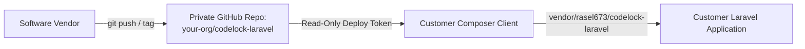

# Private Composer Distribution Guide

This guide describes how to distribute the proprietary **`rasel673/codelock-laravel`** package securely from a private GitHub repository without publishing to public Packagist.

---

## 1. Distribution Architecture



---

## 2. Option A: GitHub Fine-Grained Personal Access Token (Recommended)

This method provides scoped access without granting access to other repositories in your GitHub organization.

### Step 1: Create Scoped Read-Only Token on GitHub
1. Log into your vendor GitHub account: **Settings** $\rightarrow$ **Developer settings** $\rightarrow$ **Personal access tokens** $\rightarrow$ **Fine-grained tokens**.
2. Click **Generate new token**.
3. Name: `codelock-client-distribution-token`.
4. Expiration: Set to 1 year (or custom client contract duration).
5. **Repository access:** Choose **Only select repositories** $\rightarrow$ Select `your-organization/codelock-laravel`.
6. **Permissions:**
   - **Repository permissions** $\rightarrow$ **Contents**: select **Read-only**.
   - (All other permissions: *No access*).
7. Generate token and copy the string (e.g., `github_pat_11A...`).

### Step 2: Configure Customer Environment

#### Method 1: Via Composer CLI Command (Recommended)
On the customer's cPanel or deployment server:
```bash
composer config --auth github-oauth.github.com "github_pat_11A...YOUR_TOKEN"
```
This automatically writes to the local project's `auth.json` file.

#### Method 2: Via Manual `auth.json`
Create or edit `auth.json` in the root of the customer's Laravel project:
```json
{
    "github-oauth": {
        "github.com": "github_pat_11A...YOUR_TOKEN"
    }
}
```

> [!IMPORTANT]
> Always ensure `auth.json` is added to the customer project's `.gitignore` to prevent committing deployment credentials to their version control:
> ```gitignore
> /auth.json
> ```

### Step 3: Add Private Repository to Customer `composer.json`
In the customer application's `composer.json`:
```json
{
    "name": "client/enterprise-app",
    "repositories": [
        {
            "type": "vcs",
            "url": "https://github.com/your-organization/codelock-laravel.git"
        }
    ],
    "require": {
        "php": "^8.2",
        "rasel673/codelock-laravel": "^1.0"
    }
}
```

### Step 4: Run Composer Install
```bash
composer require rasel673/codelock-laravel
```
Composer will authenticate using the read-only token, clone the private repository archive into `vendor/rasel673/codelock-laravel`, and lock the release version in `composer.lock`.

---

## 3. Option B: SSH Deploy Keys (For Dedicated VPS & CI/CD)

If the customer application is hosted on a dedicated Linux VPS or CI/CD runner:
1. In the customer server shell, generate an SSH key:
   ```bash
   ssh-keygen -t ed25519 -C "codelock-deploy-key" -f ~/.ssh/codelock_deploy
   ```
2. In GitHub: Navigate to `your-organization/codelock-laravel` $\rightarrow$ **Settings** $\rightarrow$ **Deploy keys** $\rightarrow$ **Add deploy key**.
3. Paste `codelock_deploy.pub`. **Do NOT check "Allow write access"**.
4. In the customer server's `~/.ssh/config`:
   ```ssh-config
   Host github.com-codelock
       HostName github.com
       User git
       IdentityFile ~/.ssh/codelock_deploy
       IdentitiesOnly yes
   ```
5. In customer's `composer.json`:
   ```json
   "repositories": [
       {
           "type": "vcs",
           "url": "git@github.com-codelock:your-organization/codelock-laravel.git"
       }
   ]
   ```

---

## 4. Option C: Private Satis Mirror (For High-Volume Vendor Networks)

If deploying to dozens of client instances, run a private Satis mirror on your VPS:
1. Deploy Satis: `composer create-project composer/satis --stability=dev`.
2. Configure `satis.json` with your private repository list.
3. Protect the Satis HTTP endpoint with Nginx Basic Authentication (`auth_basic`).
4. In customer `composer.json`:
   ```json
   "repositories": [
       {
           "type": "composer",
           "url": "https://packages.yourdomain.com"
       }
   ]
   ```
5. Customer credentials configured in `auth.json`:
   ```json
   {
       "http-basic": {
           "packages.yourdomain.com": {
               "username": "customer_client",
               "password": "<STRONG_CLIENT_PASSWORD>"
           }
       }
   }
   ```
